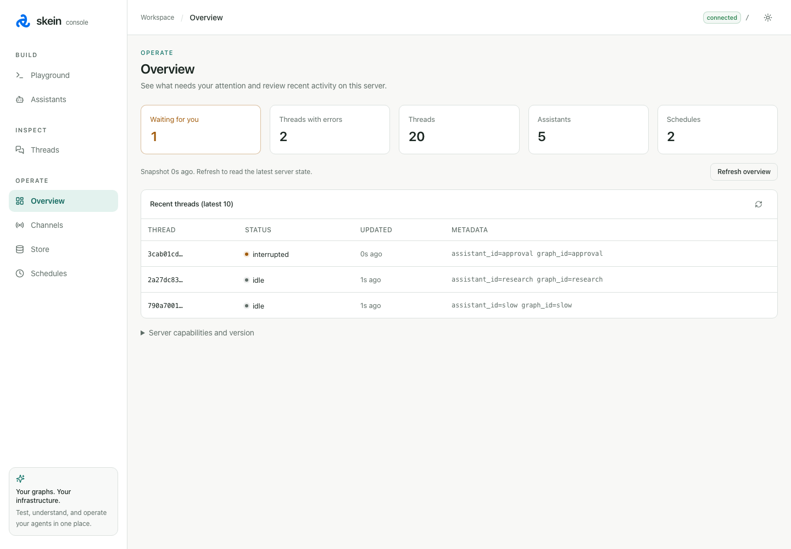

# skein-js

[](https://www.npmjs.com/package/skein-js)&nbsp;[](https://www.npmjs.com/package/skein-js)&nbsp;[](./LICENSE)&nbsp;[](https://github.com/skein-js/skein-js/actions/workflows/ci.yml)&nbsp;[](https://skein-js.github.io/skein-js/)

**Run LangGraph.js agents on your own infrastructure.**

skein-js is an open-source TypeScript runtime for hosting
[LangGraph.js](https://docs.langchain.com/oss/javascript/langgraph/overview) agents. LangGraph defines
and executes your graphs; Skein provides the API, persistence, streaming, background work, and console
around them.

## Why skein-js?

A graph that works in a script still needs a backend before people can use it. Conversations need
state, long-running work needs a queue, and people need a way to see what happened or approve the
next step. Building and maintaining that infrastructure takes time away from your application.

Skein supplies that backend. Keep your graph code, models, and tools, then run it as a service on
your infrastructure or inside an application you already ship. It is an Apache-2.0 alternative to
LangGraph Platform (now LangSmith Deployment), with no commercial license key required.

Build a customer-facing assistant, a research tool, or a workflow that waits for human approval.
Your existing LangGraph SDK clients and Agent Chat UI connect through the same Agent Protocol:
the HTTP and streaming API around your graphs.

## What you get

- **Conversation state and long-term memory.** Keep conversation history and recall information
  across threads. Use Postgres for shared servers or SQLite for local persistence.
  [State and persistence](./docs/state-and-context.md) · [Memory](./docs/memory.md)
- **Streaming with standard LangGraph clients.** Deliver tokens, tool activity, and graph updates as
  they happen. Connect with the LangGraph SDK and its frontend bindings, including React's
  `useStream`. [Streaming](./docs/streaming.md) · [Client integration](./docs/react-sdk.md)
- **Human approvals and checkpoint history.** Expose LangGraph interrupts to your users, resume
  after a decision, and explore a different outcome from a saved checkpoint.
  [Human-in-the-loop](./docs/human-in-the-loop.md) · [Time travel](./docs/threads.md#time-travel-re-run-a-turn-a-different-way)
- **Background jobs and schedules.** Let work continue after a request ends, run agents on a
  schedule, and receive a callback when a run finishes.
  [Background jobs](./docs/background-jobs.md) · [Schedules](./docs/crons.md)
- **Channels and durable callbacks.** Connect authenticated events from your systems to a graph and
  deliver its outcome to an allowed destination. Inspect and replay webhook deliveries.
  [Channels](./docs/channels.md) · [Webhooks](./docs/webhooks.md) · [Native access and BullMQ](./docs/native-access.md)
- **Console and observability.** Test graphs, inspect conversations, and manage approvals in your own
  console. Connect LangSmith, PostHog, or OpenTelemetry for tracing and analytics.
  [Console](./docs/console.md) · [Observability](./docs/observability.md)

## Quick start

> 🚧 **Status: pre-alpha, but end-to-end.** Development and self-hosted production work today, with
> Fetch, Express, Fastify, NestJS, and Next.js adapters. See the [roadmap](./docs/roadmap.md).

Use **Node 24** (recommended), then create a project:

```bash
npm create skein-js@latest my-agent
cd my-agent
npm run dev
```

Accept the scaffolder's defaults to install dependencies and start with an echo graph that needs no
API key, database service, or Docker. Open <http://localhost:2024/console>, create a thread, and send a
message. The server runs at <http://localhost:2024>.

[Your first agent](./docs/your-first-agent.md) walks through adding a model and tools, then deploying.
For workspace setup and generator options, see [scaffolding](./docs/scaffolding.md).

### Already using LangGraph?

Install the CLI in your existing project:

```bash
npm install -D skein-js
```

Then change your development script:

```diff
- "dev": "langgraph dev"
+ "dev": "skein dev"
```

Keep your `langgraph.json`, graph exports, and clients. See
[LangGraph CLI compatibility](./docs/langgraph-cli-compat.md) for supported commands, fields, and
limitations.

## Run it your way

Each path uses the same Agent Protocol engine. Choose where the runtime lives:

| Path                  | Use it for                                                                      | Guide                                                             |
| --------------------- | ------------------------------------------------------------------------------- | ----------------------------------------------------------------- |
| **Standalone server** | A shared agent service with Postgres and Redis, deployed as Node or a container | [Server deployment](./docs/deploy.md)                             |
| **Existing backend**  | Graphs mounted alongside your Express, Fastify, NestJS, or Next.js routes       | [Embedding](./docs/embedding.md) · [Adapters](./docs/adapters.md) |
| **Local application** | A desktop app, CLI, or daemon with one Node process owning a SQLite file        | [Local deployment](./docs/local-deployment.md)                    |

The default development server uses memory drivers. Select durable storage when you need state to
survive beyond development. Your application chooses its models, credentials, and tools in every
path.

## The console

The console is served by your own process at `/console`. Send a message in the playground, follow
live runs, review pending approvals, and browse saved memory and schedules.



It is enabled during development and **off by default in production**. The
[console guide](./docs/console.md) covers access, configuration, and the full tour.

## Documentation

[Read the docs](https://skein-js.github.io/skein-js/) for the complete guides and reference.

- [Getting started](./docs/getting-started.md) — adopt Skein with a new project or an existing graph.
- [Features](./docs/features.md) — find a capability and its guide.
- [Agent Protocol](./docs/agent-protocol.md) — API resources and authentication.
- [Recipes](./docs/recipes/index.md) — practical patterns for serving and running agents.
- [Agent skills](./docs/agent-skills.md) — setup guidance for AI coding assistants.

LangChain Deep Agents support is **experimental**: see the
[Deep Agents recipe](./docs/recipes/deep-agents.md).

For AI tools, [llms.txt](./llms.txt) indexes the docs and [llms-full.txt](./llms-full.txt) bundles them.

## Examples

Start with [triage-agent](./examples/triage-agent) for background work, schedules, and approvals
without an API key, or [chat-app](./examples/chat-app) for a research assistant with a Next.js UI.
The [examples directory](./examples) also includes framework integrations, migration, and local apps.

## Contributing & feedback

[Open an issue](https://github.com/skein-js/skein-js/issues) for bugs and compatibility reports, or
see [CONTRIBUTING.md](./CONTRIBUTING.md) to contribute. Changes and releases are in the
[changelog](./CHANGELOG.md).

## Sponsorship

Sponsored by [Garatropic Studios](https://garatropic.com), supporting engineering and ongoing
maintenance. To support development, [get in touch](https://github.com/skein-js/skein-js/issues).

## License

[Apache-2.0](./LICENSE)
