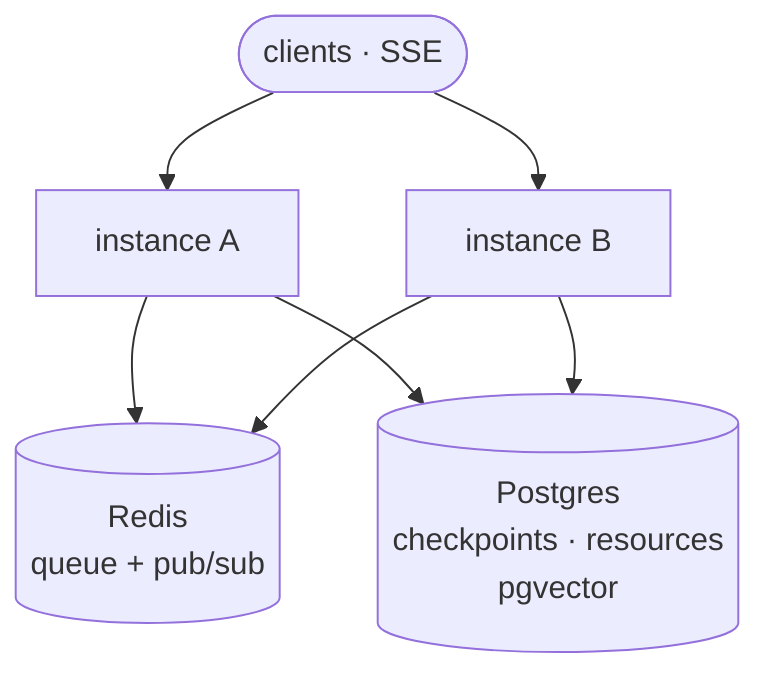

# Runs & Redis

Choose a queue for background runs and configure concurrency for your deployment. Use memory
while developing, SQLite for one local Node owner, and Redis when workers or streaming clients span
server instances. For submitting individual runs, start with [Runs](./runs.md).

`@skein-js/redis` supplies the queue and cross-instance event delivery. It is not a graph checkpointer;
Postgres or another configured saver holds checkpoint history.

## Run modes

Choose wait, streaming, or background execution using the [run-mode guide](./runs.md#pick-a-run-mode).
Runs on the same thread are serialized. Run concurrency below controls how many different threads
one instance executes at once.

## Inspect execution {#run-engine}

Keep the thread ID and run ID returned by submission. Read the run's status or open it in the
[console](./console.md#runs). A failed run retains its error for later inspection; see
[Errors & logging](./errors-and-logging.md). Joining a stream observes existing work rather than
submitting another run.

## Queue drivers

| Deployment                        | Queue  | Recovery                                                   |
| --------------------------------- | ------ | ---------------------------------------------------------- |
| Development and isolated tests    | Memory | Pending queue work is process-local                        |
| One local Node owner              | SQLite | Unclaimed jobs survive; abandoned attempts become failures |
| Shared server or multiple workers | Redis  | Delayed jobs survive and stalled work can be redelivered   |

Choose the matching store/queue configuration in your CLI or embedding helper. An `after_seconds`
delay starts work no earlier than its due time. Its survival across restart depends on the selected
queue, as described below. Make external effects idempotent when retries are possible.

### In-memory (dev)

- Single-process queue + event bus. No external services.
- Used by `skein dev` so nothing beyond Node is required locally.
- An `after_seconds` delay is a local timer, so it is lost on restart — like every other run already
  sitting in this queue, which is in-process too.

### SQLite (local applications)

- `@skein-js/storage-sqlite` persists the queue in the same file as protocol resources, owned by
  one process. `@skein-js/local` adds the upstream checkpointer and process-local event bus.
- Run creation and background-job admission commit together. Unclaimed jobs retain their original
  due times across reopening; duplicate enqueue does not shorten a delay.
- Claimed or executing attempts abandoned by a process become `ProcessLostError` failures. Skein
  does not replay their input or resume checkpoints automatically. The application decides.
- Live stream frames stay in memory. This is a Node 22/24/26 option for local apps and single-owner
  services, with no distributed worker support. See [local deployment](./local-deployment.md).

### `@skein-js/redis` (shared servers)

- **Job queue ([BullMQ](https://docs.bullmq.io))** — background runs are enqueued in Redis; worker
  processes across instances consume and execute them. BullMQ provides retries, backoff, and
  concurrency out of the box.
- **Crash recovery** — BullMQ redelivers stalled background jobs. Skein continues the same run
  from its latest attributable checkpoint, using LangGraph's pending work rather than applying
  the accepted input or resume command again. If no input checkpoint committed, the original
  input is still needed. A finished graph awaiting resource settlement is settled without rerunning it.
- **Delayed runs** — an `after_seconds` delay is handed to BullMQ's own delayed set, which lives in
  Redis and promotes the job when it comes due, so a scheduled run outlives the process that created it.
- **Cross-instance pub/sub** — run stream frames are published to a Redis Stream + channel so a
  client connected to instance B can join a run executing on instance A (see [streaming.md](./streaming.md)).
- **Cross-instance cancellation** — a `RunAbortChannel` over Redis pub/sub carries the _stop now_ signal
  to whichever instance is executing a run, so a cancel routed to the wrong replica still stops the
  graph. The cancel itself is durable in the run row before the message is published, so a dropped
  message costs promptness rather than correctness. See
  [deploy.md](./deploy.md#scaling-past-one-instance).

#### Recover after a worker exits

Keep Postgres and Redis, then start a worker against the same databases. BullMQ's stalled-job
interval determines when it redelivers the attempt. Inspect the original run ID; a cancelled or
already settled run is not restarted. Human-input interrupts remain paused.

Make external effects idempotent using a stable application operation key. A node that ran before
its checkpoint committed can run again; checkpoint recovery does not make a remote API call and
the checkpoint one transaction. Existing stream-history limits still apply to reconnecting observers.
Only checkpointed graph state is recoverable. A custom-stream reply emitted before process loss
is not itself a checkpoint; retain any reply your application must reconstruct in graph state.

Skein supplies run/thread execution identity and attributes new checkpoint writes independently
of tracing. Assistant/graph tracing metadata retains its existing telemetry behavior, so enabling
recovery does not change application-owned configurable IDs or legacy store namespaces. A running attempt
from an older version whose current checkpoint cannot be attributed fails with
`run_recovery_ambiguous` rather than guessing. Inspect its thread state/history and choose an
explicit resume or a new turn through the existing API. Keep the original base checkpoint for
rollback decisions. This Redis recovery behavior does not change SQLite's application-controlled
recovery policy.

For a custom execution engine, verify its own continuation semantics before claiming durable
recovery. Opaque custom-saver metadata is passed through unchanged; automatic attribution applies
to ordinary metadata records. A saver alone does not establish that an arbitrary agent can continue
its work from a checkpoint.

### Stream retention {#what-a-frame-costs}

Redis retains stream frames so a client connected to another instance can join a run or reconnect.
Set bounds for both retained events and each observer's buffer:

Two knobs bound what this costs:

| Variable                     | Default | Purpose                                                                                 |
| ---------------------------- | ------- | --------------------------------------------------------------------------------------- |
| `SKEIN_REDIS_STREAM_MAXLEN`  | 10000   | Approximate cap on a run's stream, in frames. `0` disables trimming (TTL only).         |
| `SKEIN_STREAM_BUFFER_FRAMES` | 512     | Frames one subscriber may queue before it is judged too far behind and its stream ends. |

`MAXLEN` exists because the 1-hour TTL bounds a stream in _time_ but not in size, and a chatty graph
can produce a very large one well inside an hour. Trimming is approximate (`~`), which lets Redis trim
whole nodes instead of walking the stream on every append.

A subscriber whose buffer overflows has its stream ended rather than being allowed to grow without
bound behind a reader that cannot drain it; the client reconnects with `Last-Event-ID` and replays from
the stream, which is what the stream is for.

See [streaming and reconnect](./streaming.md) for client behavior.

## Run concurrency

How many **queued** (background) runs one instance executes at once. It defaults to **10**, matching
the LangGraph CLI's `--n-jobs-per-worker`, so a project moving off `langgraph dev` keeps its
throughput. Inline `wait`/`stream` runs never touch the queue and are unaffected.

Concurrency is the knob with the widest blast radius: it multiplies memory, Postgres connections, and
in-flight graph state at once. Size it together with `PG_POOL_MAX` — see
[performance.md](./performance.md#sizing), and note `skein start` warns at boot when the two disagree.

**One worker, N concurrent runs.** skein runs a _single_ background worker whose consumer executes up
to N runs at a time — which is why the startup banner says `Starting 1 worker, up to 10 concurrent
runs` rather than `langgraph dev`'s `Starting 10 workers` (it really does spawn 10 loops; we don't).
The observable behavior is the same.

> **Upgrading from ≤ 0.9.0?** This default changed: background runs used to execute strictly one at a
> time. Nothing about your code or config needs to change, but each instance now does up to 10 runs
> concurrently — so check that your Postgres pool has headroom (see
> [pool sizing](./deploy.md#connection-budget)), and note that background runs on one thread
> using `multitask_strategy: "enqueue"` no longer execute in strict enqueue order. Set
> `SKEIN_RUN_CONCURRENCY=1` (or `--concurrency 1`) to restore the previous behavior exactly.

Three ways to set it, highest precedence first:

| Surface        | How                                                                          |
| -------------- | ---------------------------------------------------------------------------- |
| CLI flag       | `skein dev --concurrency 4` / `skein start -n 4` (`--n-jobs-per-worker` too) |
| Environment    | `SKEIN_RUN_CONCURRENCY=4`, or the LangGraph-compatible `N_JOBS_PER_WORKER=4` |
| Adapter option | `createExpressServer({ deps, worker: { maxConcurrency: 4 } })`               |

An explicit value wins, but the environment is still validated — so a typo'd
`SKEIN_RUN_CONCURRENCY` fails loudly at boot instead of being silently ignored. The environment is
the path that reaches a container: add it to the `skein up` compose `environment:` block or your
PaaS config.

**Per-thread ordering is unaffected.** Two runs on the same thread are serialized by the engine's
execution lock at _every_ concurrency, so the per-thread guard above holds regardless.

### Dispatch by thread

Bundled memory, SQLite and Redis queues retain a busy thread's pending head while dispatching work
for independent threads. A busy execution claim does not hold a worker execution slot or spend a
processor-failure attempt. The execution claim remains responsible for serialization, including
against inline runs and other instances. The default `multitask_strategy` remains `"reject"`;
`"enqueue"` is the strategy that builds a thread backlog.

For a custom queue, optional `RunQueue.consumePartitioned` acknowledges handled work with `true`.
Return `false` only when execution did not start; the run stays at its thread's head without spending
a failure attempt. Optional `ThreadExecutionGate.tryAcquire` returns a lease or `undefined` when busy;
backend failures reject. Older queues and gates retain blocking dispatch. Preserve original due times,
deduplication, and the execution lease when implementing these public extension contracts.

Coordinate worker upgrades so all instances use the same dispatch behavior. Existing queued jobs
can remain in place; an upgrade does not require flushing Redis. SQLite retains queued job due times
and records abandoned attempts as failures without automatic replay.

**Ordering across background `"enqueue"` runs is not guaranteed above concurrency 1.** If your
application needs a strict sequence, finish one run before submitting the next, or express the
sequence inside your graph. A busy thread should not prevent unrelated conversations from running.

**Concurrency vs. replicas.** Raise concurrency when you have many independent threads and runs are
I/O-bound (model calls). Add instances when runs are CPU-bound, or when threads are long-lived and
serialized. Note each concurrent run holds a Postgres connection — see the pool-sizing note in
[deploy.md](./deploy.md#connection-budget) — and, on the Postgres driver, a second one for its
per-thread execution claim, held for the whole run.

## Deployment topology (`skein up`)

`skein up` brings this stack up via Docker Compose. Horizontal scaling is verified by
starting a run on instance A and joining its SSE stream from instance B through Redis (see
[testing.md](https://github.com/skein-js/skein-js/blob/main/docs/testing.md)).

To run the same topology on a hosted platform, the generated image is PaaS-friendly (binds the
injected `$PORT`, non-root, `/ok` health probe, graceful `SIGTERM`) — see
[deploy.md](./deploy.md) for what every platform needs, plus per-platform guides for Cloud Run,
Railway, Fly.io, Render, AWS, Kubernetes and a plain VPS.
