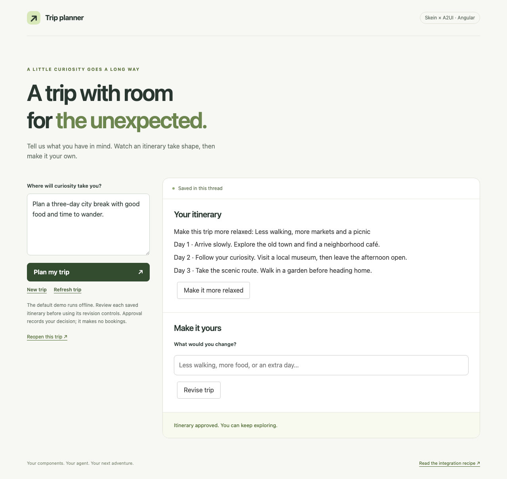

# Trip planner — Angular A2UI with Skein

Describe a trip, watch its itinerary appear, review it, then revise it through generated controls.
Reopen its thread URL to restore the saved surfaces and any pending approval.



This is a private, copyable application example. It uses the upstream A2UI 1.0 agent, core and
Angular renderer libraries with existing Skein APIs; it adds no published adapter or runtime API.

## Run it

Use Node 24 and the repository's pnpm version. From the repository root:

```sh
pnpm install
cd examples/a2ui
pnpm dev:all
```

Open **http://127.0.0.1:3007**. The shortcut runs both servers through Nx; **Ctrl+C** stops them.
Angular proxies `/api` to the graph server at `127.0.0.1:2025`. To start them separately, run
`pnpm exec nx dev example-a2ui` and `pnpm exec nx serve example-a2ui` from the repository root.

1. Select **Plan my trip**. The default generator progressively renders a scripted three-day plan.
2. **Approve itinerary** or **Reject**. This resumes a checkpointed review and records a decision;
   it makes no bookings and does not regenerate the itinerary.
3. Select **Make it more relaxed**, or enter feedback and select **Revise trip**. Review each new
   version before using its generated actions.
4. Select **Dismiss travel tips** to remove that surface without another generation or approval.
5. Follow **Reopen this trip**, or reload its URL. The saved surfaces and pending review return.
6. During generation, **Pause updates** disconnects observation only; **Reconnect** follows the
   same run. **Stop run** cancels execution and restores its latest checkpoint.

The default needs no credentials or external service. Its itinerary is a demonstration fixture,
not a search for destinations, availability or reservations.

## Generate with a model

Copy `.env.example` to `.env` in this directory, set `A2UI_MODEL` to a LangChain `provider:model`
string, and add that provider's credentials. The Google integration is installed:

```dotenv
A2UI_MODEL=google-genai:YOUR_MODEL_ID
GOOGLE_API_KEY=YOUR_API_KEY
```

Choose a model ID available to your account and restart the graph server. Other providers require
their LangChain integration in this example's dependencies. These settings stay on the backend.
Live output goes through the same upstream parser, catalog validation and application policy as
the offline fixture. Invalid output and provider errors leave the last committed trip available.

## Restore after a server restart

The normal development command uses memory and `--no-persist`: browser reloads retain state while
the server runs, but stopping it loses its threads. For a persistent local server, stop that backend
and run this command from this directory while leaving the Angular frontend running:

```sh
pnpm exec skein dev --host 127.0.0.1 --port 2025 \
  --store sqlite --queue sqlite --sqlite-path .skein/trips.sqlite
```

SQLite checkpoints and thread records survive reopening; its event history is process-local.
The application restores checkpointed UI rather than requiring old stream frames. See
[local deployment](../../docs/local-deployment.md) and the existing [deployment options](../../docs/deploy.md).

## Adapt it

| Module                                | Responsibility                                                                 |
| ------------------------------------- | ------------------------------------------------------------------------------ |
| `trip-contract.ts`                    | Narrow inputs, action policy, versioned JSON bootstrap and upstream validation |
| `generation.ts`, `trip-generation.ts` | Offline/live text and upstream Direct JSON compilation                         |
| `trip-graph.ts`                       | Checkpointed surfaces, action routing and a separate review node               |
| `ui-events.ts`                        | Per-run sequencing, scope isolation, duplicates and preview recovery           |
| `trip-client.ts`, `trip-session.ts`   | SDK admission hook, observation, restoration and cancellation                  |
| `app/`                                | Native Angular rendering, bound inputs and trusted approval controls           |
| `auth.ts`                             | Demo identity and thread ownership                                             |

The browser's `x-user: demo-user` assertion is demonstration identity, not production authentication.
Replace it with verified session/JWT identity and preserve ownership checks. Ordinary graph input
cannot supply saved UI or approval channels. Authorized state-update APIs remain a separate
deployment policy; this example does not make approval records immutable.

The SDK hook adds the existing `if_thread_status` field omitted by SDK 1.12.7, protecting a pending
review from a competing tab, and assigns a retry-stable `Idempotency-Key` to each run creation.

Supported UI uses the Basic Catalog's Text, Column, Row, Card, Button, TextField and Divider, with
`reviseTrip` and `dismissTips` events. Remote function calls, custom catalogs and navigation are
outside the example's subset. Escaped plain text uses the public `provideMarkdownRenderer` seam;
the optional Markdown package is omitted because its current core peer range differs.
The pinned renderer defaults its v1 catalog to universal elements. `createTripCatalog` pairs those
v1 schemas with its exported native Angular implementations through public component overrides;
the example keeps `useUniversalComponents: false` and the A2UI 1.0 catalog/wire format.
`TripTextField` reuses the upstream field binding and input handler with an associated HTML label
for keyboard and assistive-technology access.

Saved snapshot schema version 1 and the [recipe's tested dependency versions](../../docs/recipes/a2ui.md#tested-versions-and-limits)
define the restoration boundary. Incompatible saved trips show an error and offer **New trip**;
they are not migrated or regenerated automatically.

## Contributor checks

From the repository root:

```sh
CI=true pnpm exec nx run-many -p example-a2ui -t lint typecheck test build
pnpm exec nx run server-express:prepare-browser
pnpm exec nx run example-a2ui:test-browser
pnpm exec nx run test-support:test-a2ui-consumer
```

Browser screenshots are written to `dist/a2ui-screenshots`. The isolated consumer compiles the
actual graph/session and Angular app against packed Skein packages outside the checkout, then
executes generation, form input, approval, deletion and reopening. It also runs as part of
`test-support:test-compatibility-consumer`.
