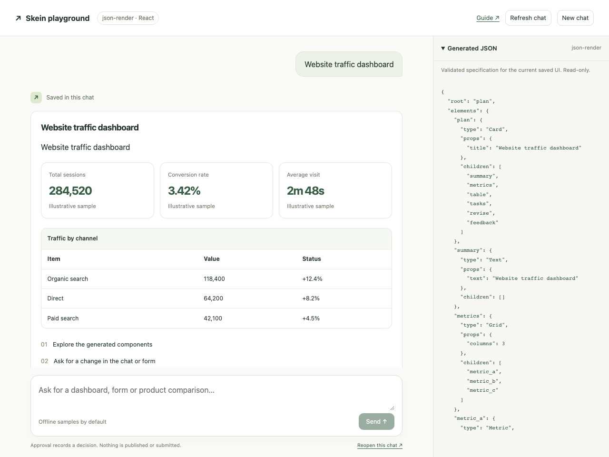

# UI playground — React json-render with Skein

Describe an interface in chat, watch it render, review it and ask for a change. The JSON panel shows the current validated UI. This private example uses existing Skein APIs and upstream rendering libraries.



## Run it

Use Node 24 and the repository's pnpm version. From the repository root:

```sh
pnpm install
pnpm --dir examples/json-render dev:all
```

Open **http://127.0.0.1:3006**. The command starts the frontend and the graph server at `127.0.0.1:2024` through Nx. **Ctrl+C** stops both. No credentials are needed for the offline samples.

## Use the playground

1. Choose a dashboard, form or product-comparison sample, or type a prompt and select **Send**.
2. Watch the generated UI and its JSON appear. The JSON panel is read-only.
3. Select **Approve UI** or **Reject**. Review records a decision and enables generated controls and the next chat turn.
4. Ask for a change in chat, select **Make it simpler**, or submit the generated feedback form.
5. Reload or follow **Reopen this chat**. Saved prompts, the latest UI and pending review return without generation.

Offline mode selects from three illustrative layouts; it is not a language model. Configure a model for other prompts within the registered catalog. Chat checkpoints store prompts and one active UI snapshot; earlier prompts stay visible while their UI is replaced. No arbitrary JavaScript, code editor or new transport is involved.

During generation, **Pause updates** disconnects observation, **Reconnect** rejoins the same run and **Stop run** cancels execution. Errors preserve the saved UI. Refresh an uncertain submission before trying again.

## Use a live model

Copy `.env.example` to `.env` in this directory and configure the backend:

```dotenv
JSON_RENDER_MODEL=google-genai:YOUR_MODEL_ID
GOOGLE_API_KEY=YOUR_API_KEY
```

Restart the graph server. The Google integration is installed; another provider needs its LangChain integration. Credentials stay on the backend. Model output goes through the same compiler, catalog validation and action policy as the offline samples.

## Adapt it

- `generation.ts`: offline layouts and optional LangChain model stream.
- `catalog.ts`: input, component/action policy and saved UI validation.
- `ui-graph.ts`: UI and prompt checkpoints, followed by a separate review node.
- `ui-events.ts`: run sequencing, duplicates and preview recovery.
- `ui-client.ts`, `ui-session.ts`: SDK admission, observation, restoration and cancellation.
- `app/`: chat layout, registered components, JSON panel and trusted review controls.

The json-render catalog contains Card, Grid, Metric, Table, Text, TaskList, Button and FeedbackForm. The upstream SpecStream compiler processes fragmented JSONL output. The local `reviseUi` action starts a new generation; trusted host controls handle approval separately.

The `x-user: demo-user` header is demo identity. Replace it with verified session/JWT identity when deploying, and retain thread ownership checks. Narrow graph input does not make separately authorized state-update APIs immutable.

## Persistence

The default command uses memory and `--no-persist`: reloading preserves state while the backend runs; stopping it loses the threads. Use the existing [durable storage options](../../docs/deploy.md) for restarts. SQLite checkpoints can survive reopening, but its event history is process-local, so restoration uses the checkpoint baseline.

## Contributor checks

```sh
CI=true pnpm exec nx run-many -p example-json-render -t lint typecheck test build
pnpm exec nx run server-express:prepare-browser
pnpm exec nx run example-json-render:test-browser
pnpm exec nx run test-support:test-compatibility-consumer
```

Screenshots go to `dist/json-render-screenshots`. The packed consumer compiles the actual graph/session modules outside the checkout. See the [adoption recipe](../../docs/recipes/json-render.md) for the supported versions and transport boundaries.
