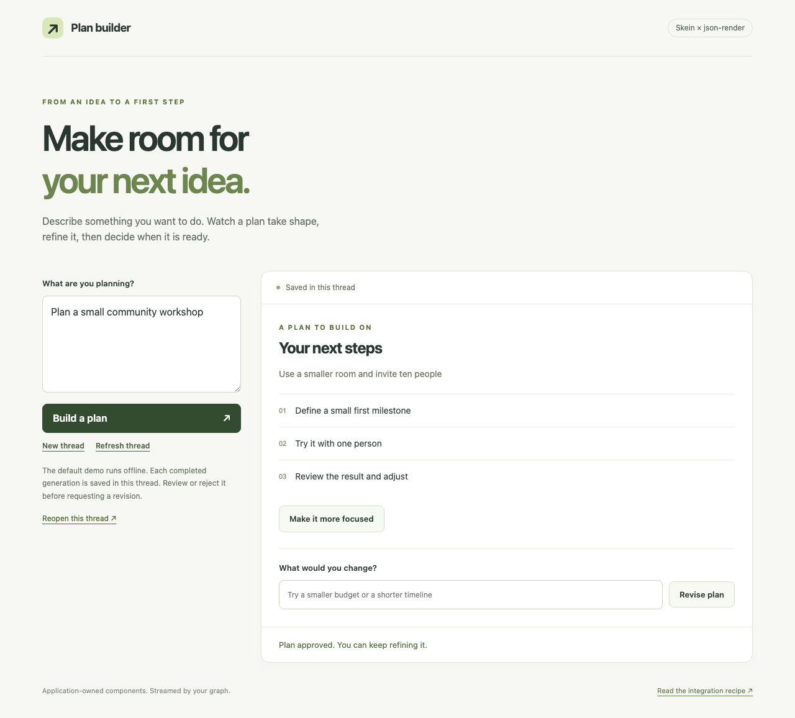

# Plan builder — json-render with Skein

Describe a plan, watch its UI appear progressively, approve or reject it, then revise it through a
generated button or feedback form. Reopen the thread's URL to restore its saved specification.



This public example is ordinary application code. `private: true` in its package manifest prevents
npm publication; the source is available to copy and adapt. It adds no Skein API or adapter package.

## Run it

Use Node 24 and the workspace's pnpm version. From the repository root:

```bash
pnpm install
pnpm exec nx dev example-json-render
```

In another terminal, also from the repository root:

```bash
pnpm exec nx serve example-json-render
```

Open **http://127.0.0.1:3006**. Vite proxies `/api` to the Skein server at `127.0.0.1:2024`.
No API key, external service, or Docker is needed. The default generator emits a scripted plan with
fixed tasks; it exercises the same compiler, graph, HTTP transport, renderer and approval path as
live generation.

1. Select **Build a plan**. The card and tasks appear before generation finishes.
2. **Approve plan** or **Reject**. This resumes the graph's interrupt and records your decision;
   it performs no external action.
3. Select **Make it more focused**, or submit the generated feedback form, to start another turn.
4. Follow **Reopen this thread**, or reload the page. The saved UI and pending review are restored.
5. While a run is active, **Pause updates** disconnects observation; **Reconnect** rejoins the same
   run. **Stop run** cancels execution and restores saved state.

The example's development target uses memory with `--no-persist`. Browser reloads preserve a thread while that server
remains alive; stopping the server loses its threads and checkpoints. Use the existing
[durable deployment options](../../docs/deploy.md) when state must survive process restarts.

## Generate with a model

Copy `.env.example` to `.env` in this directory. Set `JSON_RENDER_MODEL` to a LangChain
`provider:model` string and provide that provider's credentials. For Google, the integration is
already installed:

```dotenv
JSON_RENDER_MODEL=google-genai:YOUR_MODEL_ID
GOOGLE_API_KEY=YOUR_API_KEY
```

Choose an available model ID from your provider. Restart the graph server. Credentials remain in
the backend; the Vite client does not read this file. For another provider, install its LangChain
integration in this example before selecting it. Live generation uses the catalog's prompt and the
previous saved specification as context, then validates a complete replacement before saving.
Provider failures or invalid output leave the last valid UI available.

## Adapt it

| Module                                     | Responsibility                                                        |
| ------------------------------------------ | --------------------------------------------------------------------- |
| [`catalog.ts`](./src/catalog.ts)           | Application components, action/input schemas and upstream validation  |
| [`generation.ts`](./src/generation.ts)     | Offline SpecStream fixture and optional LangChain model               |
| [`plan-graph.ts`](./src/plan-graph.ts)     | Custom chunks, checkpointed UI and a separate approval node           |
| [`ui-events.ts`](./src/ui-events.ts)       | Generation sequencing around the upstream SpecStream compiler         |
| [`plan-client.ts`](./src/plan-client.ts)   | SDK request hook for idempotent run creation across transport retries |
| [`plan-session.ts`](./src/plan-session.ts) | SDK run observation, restoration, reconnect and cancellation          |
| [`app.tsx`](./src/app/app.tsx)             | Registered React components and trusted review controls               |
| [`auth.ts`](./src/auth.ts)                 | Demo authentication and thread ownership                              |

The browser's `x-user: demo-user` header is a **demo identity assertion**, not production
authentication. Replace the Auth callback with session/JWT verification and keep thread ownership
checks. Unused HTTP store access is denied. Generated actions can only request revisions; approval
controls are authored by the application and resume the current generation's interrupt.

Configure SDK clients with `onRequest: addRunIdempotency` from `plan-client.ts`. It assigns one
`Idempotency-Key` to each run-creation request before the SDK retries it, so a lost successful
response cannot create a second generation or resume. Each new turn or decision gets a new key.

The [json-render recipe](../../docs/recipes/json-render.md) explains the transport bridge, retention
fallback, supported versions and steps for using this pattern in an existing application.

## Contributor checks

From the repository root:

```bash
CI=true pnpm exec nx run-many -p example-json-render -t lint typecheck test build
pnpm exec nx run server-express:prepare-browser
pnpm exec nx run example-json-render:test-browser
pnpm exec nx run test-support:test-compatibility-consumer
```

The browser target captures desktop/mobile journeys under `dist/json-render-screenshots`.
The compatibility consumer compiles the actual graph/catalog/bridge modules outside the workspace
against packed Skein packages, without repository path aliases.
